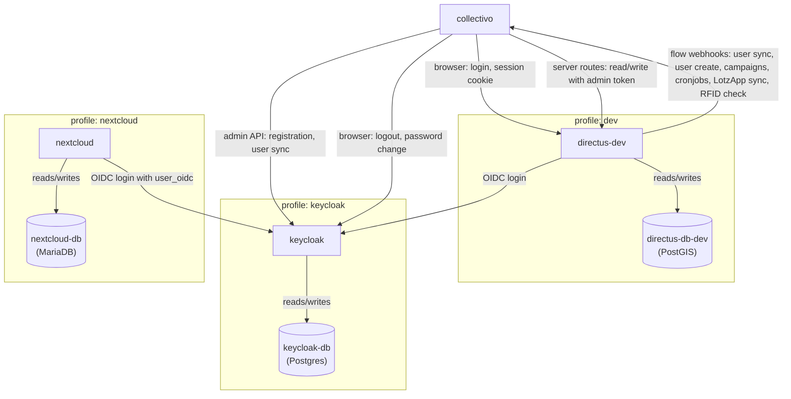

# MILA Mitgliederplattform

Member platform of [MILA Mitmach-Supermarkt e.G.](https://www.mila.wien/).

## Functionality

The software implements the following features needed for running a cooperative supermarket:

- **Registration and membership**: online membership application, processing of applications, user-editable member profiles, co-shoppers.
- **Shifts**: shift calendar, sign-up for regular and one-time shifts, absences, shift skills and categories, a shift log, and email reminders before upcoming shifts.
- **Shopping eligibility**: shift counter to determine members' shopping entitlement with notices before and when it expires.
- **Check-in**: API that a card reader at the store entrance calls to check whether a member may shop.
- **Messages**: email campaigns, templates, and automated emails to members.
- **Assortment**: members can suggest products and see responses, and can pre-order products in the shop of the ERP system [LotzApp](https://lotzapp.at/).
- **Receipts**: members can view their purchase receipts from LotzApp.
- **Solidarity fund**: members can request money from the solidarity fund and see its current status.
- **Buddy system**: members can offer or ask for a buddy to help them get started.
- **Administration**: admins can manage members, shifts, and content in the Directus admin interface.
- **Single sign-on**: one account for the member platform and other services.

## Architecture

The main components are:

- **Collectivo**: web app built with the JavaScript framework [Nuxt](https://nuxt.com/) that uses [Vue.js](https://vuejs.org/) for the user interface.
- [**Directus**](https://directus.com/): headless content management system (CMS) that provides the API and admin interface for the member database, containing user and membership, shifts, messages, and other data.
- [**Nextcloud**](https://nextcloud.com/): file storage and groupware.
- [**Keycloak**](https://www.keycloak.org/): identity provider that serves as single-sign on using the OpenID Connect (OIDC) protocol.

The diagram shows the local development setup from `docker-compose.yml` with nodes representing Docker services and boxes [Docker Compose profiles](https://docs.docker.com/compose/how-tos/profiles/). Arrows point from the caller to the service it calls.



## Repository structure

- `collectivo/`: Nuxt app (frontend + server routes)
- `directus/`: Dockerfile/entrypoint for the Directus image
- `directus-config/`: Directus schema/collections, synced via `directus-sync`
- `keycloak/`: Keycloak Dockerfile, themes, realm import/export
- `nextcloud/`: Keycloak integration notes for Nextcloud

## Local development setup

By default, the setup runs with just Collectivo and Directus using the `dev` Docker Compose profile. Keycloak and Nextcloud can be enabled via additional profiles.

### Collectivo and Directus

#### Installation

- Install Docker, nodejs, and PNPM and make sure the Docker daemon is running.
- Clone this repository.
- Create .env files:
  ```sh
  cp .env.example .env
  cp collectivo/.env.example collectivo/.env
  ```
- Start the containers and wait for directus to be ready:
  ```sh
  docker compose up --wait
  ```
- Give directus access to directories (runs as user `node`):
  ```sh
  docker compose exec -u root directus-dev chown -R node:node /directus/extensions /directus/uploads
  ```
- Apply data schema:
  ```sh
  npx directus-sync push
  ```
- Install JavaScript packages:
  ```sh
  pnpm i
  ```
- Start collectivo:
  ```sh
  pnpm dev
  ```
- Go to http://localhost:3000 and click on "Seed Example Data" (fast, small dataset) or run `pnpm seed`
  - For a production-scale dataset, click "Seed Full Dataset" instead - this takes a few minutes

The following services will then be available:

- Frontend http://localhost:3000
- Directus http://localhost:8055

Test users for frontend and directus (after seeding):

- `admin@example.com` / `admin`
- `editor@example.com` / `editor`
- `user@example.com` / `user`

Login credentials for directus admin without keycloak:

- Username `admin@example.com`
- Password `admin`

#### Troubleshooting

To reset everything:

- Overwrite `.env` and `collectivo/.env` with the examples.
- To be super clean, also delete `node_modules`, `collectivo/node_modules`, and `collectivo/.nuxt`
- Run `docker compose down -v`

### Keycloak

To test keycloak integration:

- In `.env`, set
  ```
  COMPOSE_PROFILES = "dev,keycloak"
  DIRECTUS_AUTH_PROVIDERS = "keycloak"
  ```
- In `collectivo/.env`, set
  ```
  NUXT_PUBLIC_USE_KEYCLOAK = "true"
  ```
- Add the following to your /etc/hosts file ([here is a guide](https://www.howtogeek.com/27350/beginner-geek-how-to-edit-your-hosts-file/)): `127.0.0.1 keycloak` (required so your browser uses the same hostname as Docker internally, which must match the issuer embedded in Keycloak's tokens)
- Open the Keycloak admin UI at [keycloak:8080/admin](http://keycloak:8080/admin).
- Login  with `kc-master-admin@example.com` / `admin` (user in the "master" realm provisioned by `KC_BOOTSTRAP_ADMIN_USERNAME/PASSWORD`)
- To use directus with keycloak
  - Make sure collectivo is running (`pnpm dev`)
  - Login with `kc-admin@example.com` / `admin` (user in the collectivo realm). Directus provisions a user but denies access to admin interface.
  - Click "Change user" and log in to `admin@example.com` / `admin` (not through keycloak).
  - From the user directory on the sidebar, find kc-admin@example.com and set role > admin.

The collectivo realm contains users with kc prefix to avoid conflicts with the users already seeded in directus:

- `kc-admin@example.com` / `admin`
- `kc-editor@example.com` / `editor`
- `kc-user@example.com` / `user`

For more details see the [Keycloak readme](keycloak/README.md).

### Nextcloud

- In `.env`, set `COMPOSE_PROFILES = "dev,keycloak,nextcloud"`. Nextcloud depends on the keycloak profile.
- Open the Nextcloud GUI at [localhost:8081](http://localhost:8081) and create an admin user to finish the installation.

For setup of the integration with keycloak see the [Nextcloud readme](nextcloud/README.md).

## Development

### Checks and Continuous Integration (CI)

- Lint: `pnpm lint` (fix with `pnpm lint:fix`)
- Format: `pnpm format` (fix with `pnpm format:fix`)
- Type check: `pnpm typecheck`
- Unit tests: `pnpm test` (Vitest, `collectivo/tests/unit/`)
- End-to-end tests: with Collectivo running on http://localhost:3000, run `npx cypress open` (interactive) or `npx cypress run` in `collectivo/` (Cypress, `collectivo/cypress/e2e/`)
- CI ([`.github/workflows/ci.yml`](.github/workflows/ci.yml)) runs the type check on every push and pull request. Run the other checks locally before pushing.

### Database schema

Collectivo uses [directus-sync](https://github.com/tractr/directus-sync) to apply the database schema and other directus configuration.

#### Updates

- Make changes to the database schema on your local system.
- Update the database schema in the repository and sort json entries to avoid spurious diffs:
  ```sh
  npx directus-sync pull && node sort-directus-config.mjs
  ```
- Create a database [backup](#backups).
- Run
  ```sh
  npx directus-sync push
  ```
  (credentials will be taken from .env)

#### Troubleshooting

- Changing the directus version also changes the schema. Pull the schema after changing the version and starting the container.
- Changing flows often creates errors on push, this can be solved by deleting the changed flows manually before pushing.
- When changing the directus version, push the schema first, then change the directus version, and then pull the schema again.

#### Backups

Database backups are not managed by Docker Compose. The Directus database is an external PostgreSQL instance; backups must be handled by the database host provider or a separate backup tool.

For local development, you can create a manual backup of `directus-db-dev`:

```sh
docker compose exec directus-db-dev pg_dump --clean -U directus directus > my-backup.sql
```

To restore it:

```sh
docker compose exec -T directus-db-dev psql -U directus -d directus < my-backup.sql
```

To reset the dev database before restoring (this will delete all data):

```sh
docker compose down -v
docker compose up --wait directus-db-dev
# wait for healthy, then restore
```

## Production

### Setup

- Install Docker and PNPM
- Create a sync lock file `"/directus/uploads/sync.lock"`
- Provision an external PostgreSQL database (with PostGIS extension) for Directus
- Provision an external PostgreSQL database for Keycloak
- Set .env vars
  - Generate secure secrets, keys, and passwords
  - Set `DIRECTUS_DB_HOST` to the hostname of the external Directus database
  - Set `KEYCLOAK_DB_HOST` to the hostname of the external Keycloak database
  - Remove variable `KEYCLOAK_COMMAND` (absence triggers production mode)
- [Set up a reverse proxy](https://www.linode.com/docs/guides/using-nginx-proxy-manager/) with a docker network called `proxiable`
- Set the following [custom Nginx configuration](https://stackoverflow.com/questions/56126864) for Keycloak
  ```
  proxy_buffer_size   128k;
  proxy_buffers   4 256k;
  proxy_busy_buffers_size   256k;
  ```
- Clone this repository
- Run `pnpm i` and `pnpm build`
- Run `docker compose -f docker-compose.production.yml up -d`

### Server updates

For deploying updates on the server:

- Create a database [backup](#backups)
- Run `git pull`
- Optional: if the directus version changed, perform the upgrade on the running server:
  - Build the new version: `docker compose -f docker-compose.production.yml build directus`
  - Run the new version: `docker compose -f docker-compose.production.yml up -d directus`
- Optional: Run `pnpm i`
- Run `pnpm build`
- Optional: If the environment configuration in .env or the docker compose file changed: Run `docker compose -f docker-compose.production.yml up -d collectivo`
- Run `docker compose -f docker-compose.production.yml restart collectivo`
- Optional: Apply database schema changes (see above)
